# Poly Haven: Textiles & Leather textures

**23 assets from [Poly Haven](https://polyhaven.com), dedicated to the public domain under [CC0](https://polyhaven.com/license).** Use them in any game, free or paid, and change them however you like; no credit is needed.

PBR textures as 1K and 2K JPG maps (colour, normal (GL and DX), roughness, AO, displacement and more). 899.0 MB in all.

This is a copy kept by [zuujis-cc0](https://github.com/zuujis-cc0) so game makers can take single files from GitHub. It is not made by or affiliated with Poly Haven: the originals, often in more formats and higher resolutions, are on [polyhaven.com](https://polyhaven.com). If they help you, consider [supporting Poly Haven](https://www.patreon.com/polyhaven/overview).

Every file is listed in [MANIFEST.tsv](MANIFEST.tsv) with its size and SHA-256. More free assets: [the Zuujis collection](https://github.com/zuujis-cc0/free-game-assets#readme).

| | | | |
| :-: | :-: | :-: | :-: |
| <a href="bi_stretch">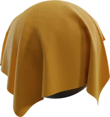</a> <b><a href="bi_stretch">Bi Stretch</a></b> by Rico Cilliers, colormass · <a href="https://polyhaven.com/a/bi_stretch">source</a> | <a href="book_pattern">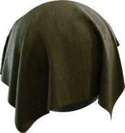</a> <b><a href="book_pattern">Book Pattern</a></b> by Rob Tuytel · <a href="https://polyhaven.com/a/book_pattern">source</a> | <a href="brown_leather">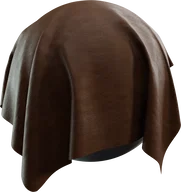</a> <b><a href="brown_leather">Brown Leather</a></b> by Rob Tuytel · <a href="https://polyhaven.com/a/brown_leather">source</a> | <a href="caban">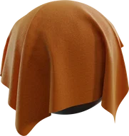</a> <b><a href="caban">Caban</a></b> by Rico Cilliers, colormass · <a href="https://polyhaven.com/a/caban">source</a> |
| <a href="cotton_jersey">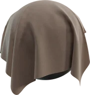</a> <b><a href="cotton_jersey">Cotton Jersey</a></b> by Rico Cilliers, colormass · <a href="https://polyhaven.com/a/cotton_jersey">source</a> | <a href="crepe_georgette">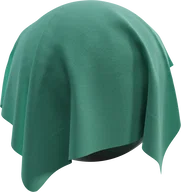</a> <b><a href="crepe_georgette">Crepe Georgette</a></b> by Rico Cilliers, colormass · <a href="https://polyhaven.com/a/crepe_georgette">source</a> | <a href="crepe_satin">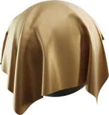</a> <b><a href="crepe_satin">Crepe Satin</a></b> by Rico Cilliers, colormass · <a href="https://polyhaven.com/a/crepe_satin">source</a> | <a href="curly_teddy_checkered">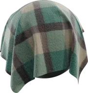</a> <b><a href="curly_teddy_checkered">Curly Teddy Checkered</a></b> by Rico Cilliers, colormass · <a href="https://polyhaven.com/a/curly_teddy_checkered">source</a> |
| <a href="curly_teddy_natural">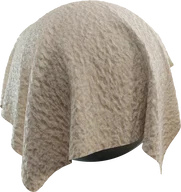</a> <b><a href="curly_teddy_natural">Curly Teddy Natural</a></b> by Rico Cilliers, colormass · <a href="https://polyhaven.com/a/curly_teddy_natural">source</a> | <a href="denim_fabric">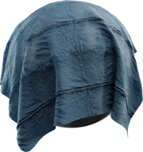</a> <b><a href="denim_fabric">Denim Fabric</a></b> by Rob Tuytel · <a href="https://polyhaven.com/a/denim_fabric">source</a> | <a href="denim_fabric_03">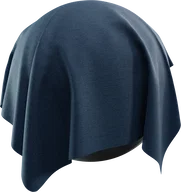</a> <b><a href="denim_fabric_03">Denim Fabric 03</a></b> by Rico Cilliers, colormass · <a href="https://polyhaven.com/a/denim_fabric_03">source</a> | <a href="denim_fabric_04">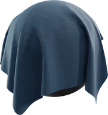</a> <b><a href="denim_fabric_04">Denim Fabric 04</a></b> by Rico Cilliers, colormass · <a href="https://polyhaven.com/a/denim_fabric_04">source</a> |
| <a href="denim_fabric_05">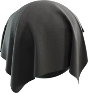</a> <b><a href="denim_fabric_05">Denim Fabric 05</a></b> by Rico Cilliers, colormass · <a href="https://polyhaven.com/a/denim_fabric_05">source</a> | <a href="denim_fabric_06">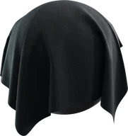</a> <b><a href="denim_fabric_06">Denim Fabric 06</a></b> by Greg Zaal, Rico Cilliers · <a href="https://polyhaven.com/a/denim_fabric_06">source</a> | <a href="denmin_fabric_02">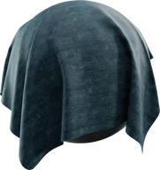</a> <b><a href="denmin_fabric_02">Denim Fabric 02</a></b> by Rob Tuytel · <a href="https://polyhaven.com/a/denmin_fabric_02">source</a> | <a href="dirty_carpet">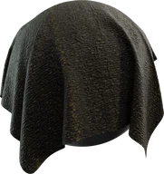</a> <b><a href="dirty_carpet">Dirty Carpet</a></b> by Rohit Seervi · <a href="https://polyhaven.com/a/dirty_carpet">source</a> |
| <a href="fabric_leather_01">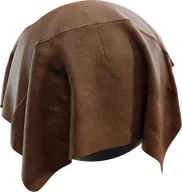</a> <b><a href="fabric_leather_01">Fabric Leather 01</a></b> by Rob Tuytel · <a href="https://polyhaven.com/a/fabric_leather_01">source</a> | <a href="fabric_leather_02">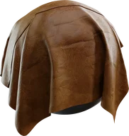</a> <b><a href="fabric_leather_02">Fabric Leather 02</a></b> by Rob Tuytel · <a href="https://polyhaven.com/a/fabric_leather_02">source</a> | <a href="fabric_pattern_05">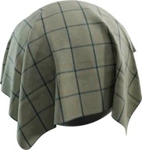</a> <b><a href="fabric_pattern_05">Fabric Pattern 05</a></b> by Rob Tuytel · <a href="https://polyhaven.com/a/fabric_pattern_05">source</a> | <a href="fabric_pattern_07">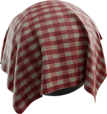</a> <b><a href="fabric_pattern_07">Fabric Pattern 07</a></b> by Rob Tuytel · <a href="https://polyhaven.com/a/fabric_pattern_07">source</a> |
| <a href="faux_fur_geometric">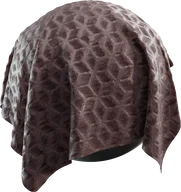</a> <b><a href="faux_fur_geometric">Faux Fur Geometric</a></b> by Rico Cilliers, colormass · <a href="https://polyhaven.com/a/faux_fur_geometric">source</a> | <a href="floral_jacquard">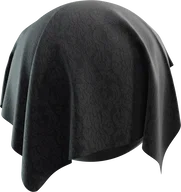</a> <b><a href="floral_jacquard">Floral Jacquard</a></b> by Rico Cilliers, colormass · <a href="https://polyhaven.com/a/floral_jacquard">source</a> | <a href="gingham_check">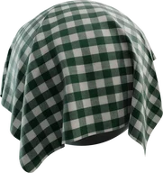</a> <b><a href="gingham_check">Gingham Check</a></b> by Rico Cilliers, colormass · <a href="https://polyhaven.com/a/gingham_check">source</a> |  |

---

Kept up to date by this repository's own [update workflow](.github/workflows/update.yml), with code and plan from [cc0-mirror](https://github.com/zuujis-cc0/cc0-mirror). Something wrong? [Open an issue there](https://github.com/zuujis-cc0/cc0-mirror/issues/new) or use the [private report form](https://games.zuujis.com/report).
